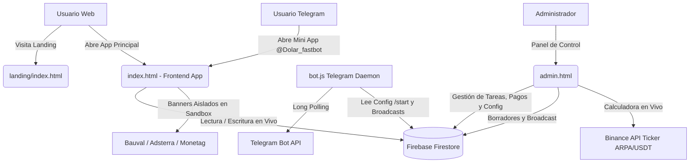

# ⚡ FastClaim — ARPA USDT Telegram Mini App & Web Platform

Plataforma Web y **Telegram Mini App** diseñada para que los usuarios ganen tokens **ARPA / USDT** gratis de forma periódica, completando tareas, invitando amigos y canjeando bonus horarios, con integración publicitaria flexible (Bauval, Adsterra, A-Ads, Monetag), base de datos en tiempo real con Firebase Firestore y sistema administrativo completo con bot daemon de Telegram.

---

## 📌 Tabla de Contenidos

- [Características Principales](#-características-principales)
- [Bot Oficial de Telegram y Mini App](#-bot-oficial-de-telegram-y-mini-app)
- [Arquitectura del Proyecto](#-arquitectura-del-proyecto)
- [Estructura del Repositorio](#-estructura-del-repositorio)
- [Novedades y Módulos Recientes](#-novedades-y-módulos-recientes)
- [Panel de Administración](#-panel-de-administración)
- [Landing Page Oficial](#-landing-page-oficial)
- [Publicidad y Monetización](#-publicidad-y-monetización)
- [Variables y Configuración](#-variables-y-configuración)
- [Despliegue y Ejecución](#-despliegue-y-ejecución)
- [Licencia](#-licencia)

---

## 🚀 Características Principales

- **Fácil Acceso Multiplataforma**: Funciona como Telegram Mini App nativa a pantalla completa o como aplicación Web responsive en cualquier navegador (`https://faslcaim.netlify.app`).
- **Bonus Recurrente de Reclamo (Claim)**: Bono periódico configurable (ej. `+1.1097 ARPA` cada X minutos/horas) con temporizador circular animado en tiempo real.
- **Sistema de Referidos**: Enlace único por usuario asociado al bot `@Dolar_fastbot` (`https://t.me/Dolar_fastbot?start=CODIGO` o `https://t.me/Dolar_fastbot/app?startapp=CODIGO`) con acreditación automática de comisión.
- **Muro de Tareas (Tasks) Avanzado**:
  - **Publicidad / Enlaces**: Tareas recurrentes con temporizador de espera (*cooldown*) en vivo para el usuario.
  - **Telegram**: Unirse a canales oficiales o reaccionar a publicaciones, registradas como misiones únicas permanentes.
- **Módulo de Retiros**:
  - Métodos soportados: **BNB Smart Chain (BEP-20)** y **Binance Pay ID**.
  - Validación de saldo y mínimo de retiro configurable desde el panel admin.
  - Avisos visuales claros para los usuarios sobre la red y formato correcto.
- **Publicidad y Banners Dinámicos**:
  - Banner en **Tareas (320x50)** y en **Inicio (728x90 / 300x250)** editables en vivo desde el panel admin sin tocar código.
  - Renderizado en **Sandbox Iframe Aislado** para proteger la interacción táctil de la Mini App.
  - Soporte para **Monetag SDK** (interstitial / rewarded ads) y Smartlink.
- **Sistema de Publicaciones y Difusión (Broadcast)**:
  - Envíos masivos simultáneos al **Canal Oficial (@fastphartner)** y a todos los usuarios del bot en Telegram.
  - Botones con **reacciones interactivas en vivo** (1 voto por cuenta de Telegram con contadores actualizables).
  - Gestor de **Borradores y Plantillas** almacenados en Firebase Firestore.

---

## 🤖 Bot Oficial de Telegram y Mini App

- **Bot Username**: [@Dolar_fastbot](https://t.me/Dolar_fastbot)
- **Direct Mini App Link**: `https://t.me/Dolar_fastbot/app`
- **Link de Referidos**: `https://t.me/Dolar_fastbot?start=<CODIGO>` o `https://t.me/Dolar_fastbot/app?startapp=<CODIGO>`
- **Canal Oficial**: [@fastphartner](https://t.me/fastphartner)
- **Host de la App en Netlify**: `https://faslcaim.netlify.app`

### Bot Daemon (`bot.js`)
El backend del bot opera mediante long-polling nativo con soporte para:
1. Respuesta dinámica a `/start` configurable desde el panel de administración (mensaje, botones de app e invitar).
2. Manejo de botones de apertura instantánea (`web_app` para chats privados y enlaces `url` para canales).
3. Sincronización del **Chat Menu Button** oficial de Telegram para abrir la app desde la esquina inferior izquierda.
4. Procesamiento de `callback_query` para registrar y editar reacciones de publicaciones con contadores en tiempo real.
5. Caché de configuración de 15 segundos para reflejar cambios del admin casi de inmediato.

---

## 🏗 Arquitectura del Proyecto



---

## 📂 Estructura del Repositorio

```text
FAst Claim/
├── admin.html                  # Panel de administración completo (Firebase Auth + Firestore)
├── index.html                  # Interfaz principal de usuario (Web & Telegram Mini App)
├── bot.js                      # Daemon del Bot de Telegram (@Dolar_fastbot)
├── firestore.rules             # Reglas de seguridad oficiales de Cloud Firestore
├── .env                        # Variables de entorno locales (tokens y URLs)
├── netlify.toml                # Configuración de despliegue y headers para Netlify
├── package.json                # Dependencias del proyecto
├── server.js                   # Servidor Node.js / Express opcional
├── README.md                   # Documentación general actualizada (este archivo)
├── landing/                    # Página de Aterrizaje (Landing Page) oficial
│   ├── assets/img/             # Capturas de pantalla e imágenes demostrativas
│   ├── index.html              # Landing informativa y captación
│   ├── style.css               # Estilos modernos, responsive y glassmorphism
│   ├── main.js                 # Calculadora interactiva y modal de acceso
│   ├── netlify.toml            # Configuración independiente de despliegue para la landing
│   ├── package.json            # Metadatos del módulo landing
│   └── README.md               # Guía de despliegue de la landing
└── db/                         # Directorio local de base de datos
```

---

## 🌟 Novedades y Módulos Recientes

### 1. 📢 Banners de Publicidad Configurables desde Admin
- **Tareas (320x50)**: Bloque publicitario colocado estratégicamente antes del listado de tareas disponibles.
- **Inicio (728x90 / 300x250)**: Bloque colocado directamente debajo del botón `¡RECLAMAR!` y antes de las estadísticas.
- **Gestión Visual**: En el panel de administración (**Configuración → Monetización & Publicidad**) se puede editar el código HTML/JavaScript de cada banner sin tocar archivos.
- **Aislamiento Seguro (`renderSafeBanner`)**: Los anuncios se renderizan dentro de un `iframe` aislado que previene interferencias con los eventos táctiles y scripts de la Mini App.

### 2. 🤖 Editor de Respuestas del Comando `/start`
- Ubicado en **Configuración → Configuración del Bot — Respuesta a /start** (con botón de acceso directo desde **Publicaciones**).
- Permite personalizar:
  - Mensaje de bienvenida con formato HTML y etiqueta dinámica `{nombre}`.
  - Texto y URL del botón principal de apertura.
  - Texto del botón de invitar y mensaje predefinido para compartir.
  - Texto del **Chat Menu Button** (botón de menú inferior del chat de Telegram).
  - Vista previa interactiva estilo Telegram en tiempo real.

### 3. 📣 Publicaciones con Reacciones y Borradores en Firestore
- Soporte para adjuntar imágenes/banners directos a través de URL (`i.ibb.co`, etc.).
- Botones de reacción rápida configurables (hasta 8 emojis). Los usuarios votan una sola vez por cuenta y el contador numérico se actualiza en el mensaje sin recargar.
- Enlace diferenciado: en canales utiliza el enlace al bot (`https://t.me/Dolar_fastbot`), mientras que en chats privados ejecuta directamente la app o el flujo `/start`.
- Sistema de **Borradores** guardados en la colección `broadcast_drafts` de Firestore para reutilizar mensajes prefabricados.

### 4. 🧮 Calculadora ARPA / USDT en Tiempo Real
- Conexión directa a la API de **Binance** (`ARPAUSDT`) para obtener el precio spot en tiempo real.
- Conversión instantánea de centavos de dólar ($0.01, $0.05, $0.50, etc.) a tokens ARPA.
- Botones rápidos para transferir el cálculo a la recompensa de Claim o de Referidos.

### 5. 🛡 Reglas de Firestore y Navegación del Admin
- Corrección estructural de contenedores DOM en `admin.html` que garantiza carga inmediata sin pantallas en negro en Tareas, Calculadora y Configuración.
- Reglas actualizadas en `firestore.rules` con permisos habilitados para `broadcast_drafts` y configuración general.

---

## 🛡 Panel de Administración (`admin.html`)

El panel administrativo incluye:
1. **Dashboard**: Métricas en vivo (usuarios totales, reclamos procesados, balances y retiros pendientes).
2. **Retiros**: Aprobación/rechazo de pagos BSC (BEP-20) y Binance Pay con botón de copiado rápido y modal de verificación.
3. **Tareas**: Creación y edición de misiones (enlaces, publicidad, canales de Telegram), temporizadores de reinicio (*cooldown*) y reinicio masivo.
4. **Usuarios & Referidos**: Directorio de usuarios registrados, estado en línea, balances individuales y tabla de patrocinadores destacados.
5. **Publicaciones**: Creador de broadcasts para canal y bot con imágenes, reacciones interactivas y borradores guardados.
6. **Calculadora ARPA**: Conversor de divisas y cripto conectado al ticker en vivo de Binance.
7. **Configuración**: Parámetros económicos (bonus amount, cooldown, mínimo de retiro), respuesta del bot `/start` y códigos de banners publicitarios.

---

## 🌐 Publicidad y Monetización

| Formato | Red / Proveedor | Ubicación | Control |
|---|---|---|---|
| **Banner 320x50** | Bauval / Adsterra / Cualquier red | Sección Tareas (`#tasksAdContainer`) | Editable desde Admin |
| **Banner 728x90 / 300x250** | Bauval / Adsterra / Cualquier red | Inicio debajo de Claim (`#homeAdContainer`) | Editable desde Admin |
| **Rewarded / Interstitial** | Monetag SDK (`//libtl.com/sdk.js`) | Al presionar ¡RECLAMAR! | Activable / Desactivable desde Admin |
| **Smartlink / Direct Link** | Monetag / Otra red | Ventana secundaria opcional al reclamar | Editable desde Admin |

---

## ⚙️ Variables y Configuración

Archivo `.env` en la raíz del proyecto:
```env
# Token del bot de Telegram obtenido de @BotFather
BOT_TOKEN=8671776491:AAFlPCgWFxY593pUMsOKAPP4LzWAzp-PjgA

# URL oficial de la Mini App alojada en Netlify
APP_URL=https://faslcaim.netlify.app

# Clave secreta administrativa
ADMIN_SECRET=fastclaim_admin_2024
```

---

## ☁️ Despliegue y Ejecución

### 1. Iniciar el Daemon del Bot Localmente
```powershell
cd "E:\FAst Claim"
node bot.js
```

### 2. Despliegue en Netlify (App Principal)
Cada commit subido a la rama `main` en GitHub despliega automáticamente los cambios en Netlify:
```powershell
cd "E:\FAst Claim"
git add .
git commit -m "feat: nuevas funcionalidades"
git push origin main
```

### 3. Despliegue de la Landing Page
La carpeta `/landing` está configurada para desplegarse como sitio complementario de captación o subdirectorio.

---

## 📄 Licencia

Este proyecto está bajo la Licencia **MIT**. Consulta el archivo `package.json` para más detalles.
