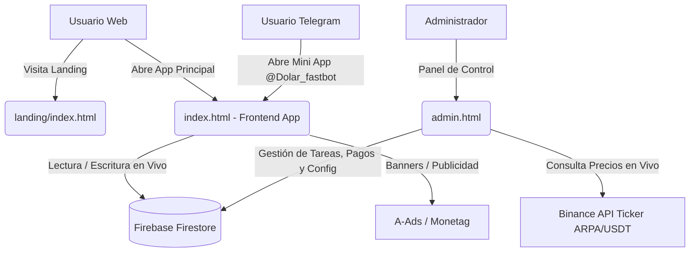

# ⚡ FastClaim — ARPA USDT Telegram Mini App & Web Platform

Plataforma Web y **Telegram Mini App** diseñada para que los usuarios ganen tokens **ARPA / USDT** gratis de forma periódica, completando tareas, invitando amigos y canjeando bonus horarios, con integración publicitaria (A-Ads y Monetag), base de datos en tiempo real con Firebase Firestore y sistema administrativo completo.

---

## 📌 Tabla de Contenidos

- [Características Principales](#-características-principales)
- [Bot Oficial de Telegram](#-bot-oficial-de-telegram)
- [Arquitectura del Proyecto](#-arquitectura-del-proyecto)
- [Estructura del Repositorio](#-estructura-del-repositorio)
- [Novedades y Módulos Recientes](#-novedades-y-módulos-recientes)
- [Panel de Administración](#-panel-de-administración)
- [Landing Page Oficial](#-landing-page-oficial)
- [Variables y Configuración](#-variables-y-configuración)
- [Despliegue](#-despliegue)
- [Licencia](#-licencia)

---

## 🚀 Características Principales

- **Fácil Acceso Multiplataforma**: Funciona como Telegram Mini App nativa mediante el bot oficial o como aplicación Web responsive en cualquier navegador.
- **Bonus Recurrente de Reclamo (Claim)**: Bono periódico configurable (ej. `+0.02 ARPA` / `+0.5 ARPA` cada hora o minutos) con temporizador en tiempo real.
- **Sistema de Referidos**: Enlace único por usuario asociado al bot `@Dolar_fastbot` (`https://t.me/Dolar_fastbot?start=CODIGO`) con acreditación automática.
- **Muro de Tareas (Tasks) Avanzado**:
  - **Tareas Publicitarias / Enlaces**: Tareas recurrentes con tiempo de espera configurable (cooldown de 20 min) y contador en vivo para el usuario.
  - **Tareas de Telegram**: Unirse a canales o reaccionar a publicaciones, marcadas como de realización única (permanentes).
- **Módulo de Retiros**:
  - Métodos soportados: **Dirección BSC (BEP-20) / BNB Smart Chain** y **Binance Pay ID**.
  - Validación de saldo y mínimo de retiro configurable.
  - Avisos visuales claros para los usuarios sobre la red correcta.
- **Monetización Dual**:
  - Banner publicitario integrado de **A-Ads** (unidad adaptativa `#2462229`) optimizado para visibilidad.
  - Soporte y direct links de **Monetag**.
- **Backend y Base de Datos**: Integración con **Firebase Firestore & Auth** para sincronización en tiempo real de saldos, tareas y solicitudes, con compatibilidad de servidor Express Node.js.

---

## 🤖 Bot Oficial de Telegram

El bot oficial vinculado a la plataforma es:
- **Bot Username**: [@Dolar_fastbot](https://t.me/Dolar_fastbot)
- **Formato del link de referidos**: `https://t.me/Dolar_fastbot?start=<CODIGO_REFERIDO>`

> [!NOTE]
> Para la correcta apertura como Mini App, el bot debe tener configurado el **Menu Button** o **Web App URL** apuntando al dominio de despliegue en Netlify vía [@BotFather](https://t.me/BotFather).

---

## 🏗 Arquitectura del Proyecto



---

## 📂 Estructura del Repositorio

```text
FAst Claim/
├── admin.html                  # Panel de administración completo (Firebase Auth + Firestore)
├── index.html                  # Interfaz principal de usuario (Web & Telegram Mini App)
├── netlify.toml                # Configuración de despliegue y headers para Netlify
├── package.json                # Dependencias del proyecto
├── server.js                   # Servidor Node.js / Express opcional
├── README.md                   # Documentación general actualizada (este archivo)
├── landing/                    # Página de Aterrizaje (Landing Page) oficial
│   ├── assets/img/             # Capturas de pantalla e imágenes demostrativas
│   ├── index.html              # Landing informativa y captación
│   ├── style.css               # Estilos modernos, responsive y glassmorphism
│   ├── main.js                 # Calculadora interactiva y modal de acceso
│   ├── netlify.toml            # Configuración independiente de despliegue para la landing
│   ├── package.json            # Metadatos del módulo landing
│   └── README.md               # Guía de despliegue de la landing
└── db/                         # Directorio local de base de datos
```

---

## 🌟 Novedades y Módulos Recientes

### 1. 🧮 Calculadora ARPA / USDT en Tiempo Real (Panel Admin)
- Conexión directa a la API pública de **Binance** (`ARPAUSDT`) para obtener el precio spot actualizado.
- Conversor bidireccional: cálculo de equivalencia de centavos de USD ($0.01, $0.05, $0.50, etc.) a tokens ARPA y viceversa.
- Tabla de referencia rápida.
- Botones de un solo clic para transferir el cálculo directamente a la configuración del **Bono de Reclamo** o de la **Recompensa por Referido**.

### 2. ⏱ Sistema Inteligente de Tareas y Cooldowns
- Tareas publicitarias con temporizador dinámico: el usuario visualiza *"En X minutos podrás reclamar otra vez"* con cuenta regresiva en vivo.
- Tareas de Telegram de un solo uso (`one_time: true`).
- Botones en el panel admin para **reiniciar tareas individuales** o **reiniciar todas las tareas** para que los usuarios puedan volver a completarlas.

### 3. 💳 Gestión Detallada de Retiros
- Soporte para **BSC (BEP20)** y **Binance Pay**.
- Panel de administración muestra la dirección completa o Pay ID sin truncar, con etiqueta distintiva de color (Badge púrpura para BSC y amarillo/ámbar para Binance Pay).
- Botón **"📋 Copiar"** rápido en cada fila de la tabla.
- Modal de aprobación con verificación visual completa de la wallet de destino antes de confirmar el pago.

### 4. 📢 Integración Publicitaria A-Ads
- Bloque publicitario adaptativo de A-Ads insertado estratégicamente entre la tarjeta de perfil y el balance.
- Manejo dinámico para asegurar visibilidad y correcta verificación por parte de los bots de auditoría de anuncios.

---

## 🛡 Panel de Administración (`admin.html`)

El panel administrativo incluye:
1. **Métricas en tiempo real**: Usuarios registrados, total de balances, retiros pendientes y reclamos.
2. **Gestión de Retiros**: Aprobación y rechazo con notas explicativas, visualización íntegra de destinos Binance Pay y BEP20.
3. **Gestor de Tareas**: Creación de tareas con enlace, recompensa, selección de tipo (Enlace Web o Canal Telegram), control de cooldown y reinicio masivo o individual.
4. **Calculadora ARPA**: Herramienta de conversión USD ↔ ARPA conectada a Binance.
5. **Ajustes del Sistema**: Modificación de bono horario, cooldown, comisión de referidos y scripts de anuncios.

---

## 🌐 Landing Page Oficial (`/landing`)

La carpeta `/landing` incluye una landing moderna pensada para conversión:
- Explicación del funcionamiento de FastClaim.
- Calculadora interactiva de proyecciones de ganancias mensuales.
- Mockups fotorrealistas de la aplicación.
- Enlaces directos a la versión Web y a la Mini App de Telegram (`@Dolar_fastbot`).

---

## ☁️ Despliegue

### Despliegue en Netlify (Recomendado)
El proyecto cuenta con configuración lista para Netlify:
- **Despliegue de la App Principal**: Seleccionar la raíz del repositorio. Las páginas `index.html` y `admin.html` se sirven de forma estática conectadas directamente a Firebase Firestore.
- **Despliegue de la Landing**: Se puede desplegar como sitio independiente usando la carpeta `landing` como directorio base o mediante arrastrar y soltar en Netlify Drop.

---

## 📄 Licencia

Este proyecto está bajo la Licencia **MIT**. Consulta el archivo `package.json` para más detalles.
