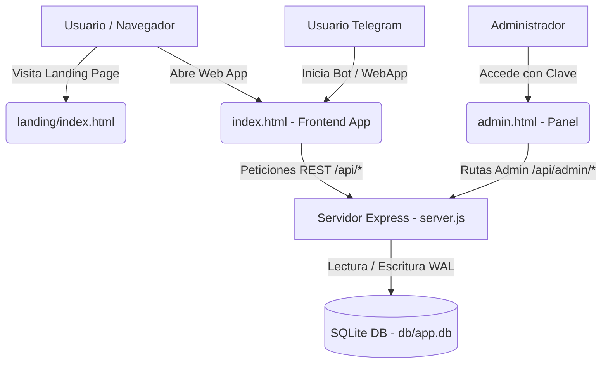

# ⚡ FastClaim — ARPA USDT Telegram Mini App & Web Platform

Plataforma Web y **Telegram Mini App** diseñada para que los usuarios ganen tokens **ARPA / USDT** gratis de forma periódica, completando tareas, invitando amigos y canjeando bonus horarios, con integración publicitaria de Monetag y sistema administrativo en tiempo real.

---

## 📌 Tabla de Contenidos

- [Características Principales](#-características-principales)
- [Arquitectura del Proyecto](#-arquitectura-del-proyecto)
- [Estructura del Repositorio](#-estructura-del-repositorio)
- [Requisitos Previos](#-requisitos-previos)
- [Instalación y Puesta en Marcha](#-instalación-y-puesta-en-marcha)
- [Variables de Entorno (.env)](#-variables-de-entorno-env)
- [Endpoints de la API](#-endpoints-de-la-api)
- [Panel de Administración](#-panel-de-administración)
- [Landing Page Oficial](#-landing-page-oficial)
- [Despliegue en Netlify y Servidores](#-despliegue-en-netlify-y-servidores)
- [Licencia](#-licencia)

---

## 🚀 Características Principales

- **Fácil Acceso Multiplataforma**: Funciona como Telegram Mini App nativa o como aplicación Web en cualquier navegador.
- **Bonus Horario de Reclamo (Claim)**: Bono recurrente configurable (por defecto `+0.5 ARPA` cada hora).
- **Sistema de Referidos**: Enlace único por usuario con recompensa automática (`1.0 ARPA` por referido).
- **Muro de Tareas (Tasks)**: Ganancias adicionales completando enlaces patrocinados, reacciones en Telegram o canales oficiales.
- **Retiros a Wallets**: Solicitudes de retiro a direcciones cripto (BEP-20 / Red TON) con límite mínimo (`10.0 ARPA`).
- **Monetización con Monetag**: Soporte integrado para zonas de anuncios Interstitial / Rewarded y Direct Link.
- **Base de Datos Ultraligera**: SQLite nativo de Node.js (`node:sqlite`) con modo WAL, sin necesidad de compilar dependencias en C++.
- **Página de Aterrizaje Separada**: Carpeta `/landing` completa y lista para conversión y despliegue independiente.

---

## 🏗 Arquitectura del Proyecto



---

## 📂 Estructura del Repositorio

```text
FAst Claim/
├── db/                         # Base de datos SQLite persistente (app.db)
├── landing/                    # Página de Aterrizaje (Landing Page) oficial
│   ├── assets/img/             # Capturas de pantalla y mockups de la app
│   ├── index.html              # HTML de la landing explicativa
│   ├── style.css               # Estilos modernos y glassmorphism
│   ├── main.js                 # Calculadora interactiva y modal
│   ├── netlify.toml            # Configuración independiente para Netlify
│   ├── package.json            # Metadatos del proyecto landing
│   └── README.md               # Guía de despliegue específica para la landing
├── admin.html                  # Panel de control del administrador
├── index.html                  # Interfaz principal de la aplicación (Frontend Web/Telegram)
├── netlify.toml                # Redirecciones y despliegue para la App raíz
├── package.json                # Dependencias del servidor Node.js
├── server.js                   # Backend Express, API REST, SQLite y Telegram Bot
└── README.md                   # Documentación general del proyecto (este archivo)
```

---

## ⚙️ Requisitos Previos

- **Node.js**: Versión `v22.0.0` o superior (para soporte nativo de `node:sqlite`).
- **NPM**: Gestor de paquetes habitual.
- **Git**: Para control de versiones.

---

## 🛠 Instalación y Puesta en Marcha

### 1. Clonar el repositorio
```bash
git clone https://github.com/wuisem051/fast-claim.git
cd fast-claim
```

### 2. Instalar dependencias
```bash
npm install
```

### 3. Iniciar el servidor local
```bash
# Modo producción
npm start

# Modo desarrollo con auto-reload
npm run dev
```

La aplicación estará accesible en:
- **App Principal**: `http://localhost:3000`
- **Panel Administrador**: `http://localhost:3000/admin` o `http://localhost:3000/admin.html`
- **Landing Page**: `http://localhost:3000/landing/index.html`

---

## 🔐 Variables de Entorno (`.env`)

Crea un archivo `.env` en la raíz del proyecto para configurar parámetros de seguridad y recompensas:

```env
# Puerto del servidor
PORT=3000

# Parámetros del sistema
BONUS_AMOUNT=0.5
BONUS_COOLDOWN_H=1
REFERRAL_REWARD=1.0
MIN_WITHDRAW=10.0

# Clave secreta para el panel de administración
ADMIN_SECRET=fastclaim_admin_2024

# Integración con Telegram Bot (Opcional para avisos/recuperación)
BOT_TOKEN=tu_token_de_botfather_aqui
```

---

## 📡 Endpoints de la API

### Usuario & Autenticación
- `POST /api/auth`: Inicia sesión o registra usuario mediante Telegram WebApp Data o credenciales Web.
- `GET /api/user/:telegram_id`: Obtiene datos, balance y estado del usuario.
- `POST /api/claim-bonus`: Reclama el bono horario si el cooldown ha expirado.
- `GET /api/tasks`: Lista de tareas disponibles.
- `POST /api/tasks/complete`: Valida y acredita recompensa de una tarea.

### Retiros
- `POST /api/withdraw`: Solicita un nuevo retiro (valida saldo suficiente y monto mínimo).
- `GET /api/withdrawals/:telegram_id`: Historial de transacciones del usuario.

### Panel Admin (`x-admin-secret: <ADMIN_SECRET>`)
- `GET /api/admin/stats`: Métricas generales (usuarios totales, saldo total, retiros pendientes).
- `GET /api/admin/withdrawals`: Listado de solicitudes de retiro.
- `POST /api/admin/withdrawals/:id/status`: Aprueba o rechaza retiros (`completed` / `rejected`).
- `GET /api/admin/settings`: Obtiene configuración global (recompensas, cooldown, Monetag).
- `POST /api/admin/settings`: Actualiza ajustes dinámicamente sin reiniciar el servidor.

---

## 🛡 Panel de Administración

El panel permite a los administradores:
1. Gestionar retiros pendientes en un clic (aprobar/rechazar con notas).
2. Modificar el monto del bono horario, recompensas por referido y límites de retiro.
3. Configurar scripts, zone ID y direct links de **Monetag**.
4. Crear y activar/desactivar tareas patrocinadas.

Acceso por defecto: `/admin` con clave configurada en `ADMIN_SECRET`.

---

## 🌐 Landing Page Oficial (`/landing`)

La carpeta `/landing` fue desarrollada para captar nuevos usuarios e inversores:
- **Explicación clara**: Qué es FastClaim y ventajas competitivas.
- **Calculadora interactiva**: Estimación en tiempo real de ganancias mensuales en ARPA y USDT.
- **Capturas de pantalla fotorrealistas**: Demostración de interfaz de dashboard y módulo de retiros.
- **Acceso rápido**: Enlaces hacia la Web App o hacia Telegram Mini App.

---

## ☁️ Despliegue en Netlify y Servidores

### Desplegar la Landing Page en Netlify (Sitio Independiente)
1. Conecta el repositorio en Netlify.
2. Define:
   - **Base directory**: `landing`
   - **Publish directory**: `landing`
3. ¡Listo! Tendrás tu landing page con HTTPS y CDN mundial.

### Desplegar la App Completa (Backend + Frontend)
El backend requiere un entorno con Node.js persistente (Render, Railway, VPS, Fly.io o DigitalOcean).
- En Netlify, el archivo `netlify.toml` de la raíz redirige las llamadas `/api/*` hacia la URL pública de tu backend en producción:
```toml
[[redirects]]
  from = "/api/*"
  to = "https://TU-BACKEND-PUBLICO.com/api/:splat"
  status = 200
  force = true
```

---

## 📄 Licencia

Este proyecto está bajo la Licencia **MIT**. Consulta el archivo `package.json` para más detalles.
